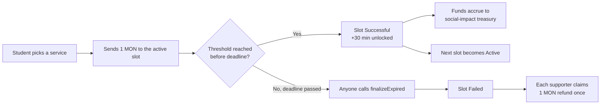
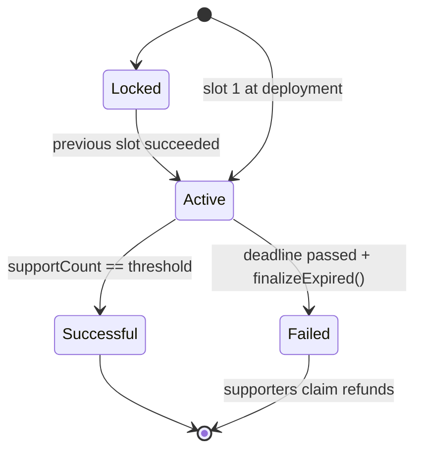
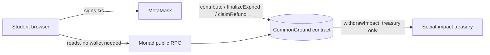

# CommonGround · CtC — Consensus then Charity

**Students pool 1 MON each to unlock a little more campus time together. If enough people commit, the slot unlocks and the money goes to charity. If not, everyone gets their MON back, guaranteed by the contract.**

| | |
|---|---|
| 🌐 **Live app** | **https://ctc-mu.vercel.app** |
| 📜 **Contract (Monad Testnet)** | [`0x864890ee1C9A005574808D5D0baF51a06AA0Aa62`](https://testnet.monadexplorer.com/address/0x864890ee1C9A005574808D5D0baF51a06AA0Aa62) |
| ⛓️ **Network** | Monad Testnet · chain ID `10143` |
| ✅ **Status** | Deployed, live-tested with two wallets, publicly hosted |

> Hackathon demo. The Library, Laundry and Cafeteria services are fictional, and no on-chain transaction proves a real-world service extension or donation.

---

## The problem

Campus resources follow fixed schedules. The library closes at midnight, the laundry room shuts at 23:00, and the cafeteria stops serving at 20:00. Students often want *just a bit more time*, but:

- **A single request doesn't count.** One student asking for longer hours is ignored. A group of them is a signal.
- **Collective pledges aren't trusted.** "I'll chip in if others do" breaks down when nobody can see who committed or be sure they'll get their money back if the plan falls through.
- **Small amounts are awkward.** Collecting 1 unit from many people by hand is slow, opaque and usually not worth the effort.

## The solution

CommonGround turns *"I'll do it if enough others do"* into a rule enforced by a smart contract:

1. **Commit:** a student sends exactly **1 MON** to the active slot of a service.
2. **Unlock:** when the slot reaches its threshold (2 supporters in this demo), it **succeeds**: the extra 30 minutes is "granted" and the next slot opens.
3. **Give:** successful commitments become **social-impact funds** that only the treasury can withdraw.
4. **Refund:** if the deadline passes before the threshold is met, anyone can close the slot, and **every supporter can reclaim their 1 MON exactly once**.

Nobody needs to trust an organiser. The rules, balances and history are on-chain and visible to everyone.



### Slot lifecycle

Each of the 3 services has **3 sequential slots**. A slot only opens after the previous one succeeds.



| Service (UI) | Contract ID | Slots |
|---|---|---|
| Central Library | `0` | 3 × 30-minute extensions |
| Laundry Hub | `1` | 3 × 30-minute extensions |
| Night Cafeteria | `2` | 3 × 30-minute extensions |

---

## Live on Monad Testnet

| Field | Value |
|---|---|
| Contract | [`0x864890ee1C9A005574808D5D0baF51a06AA0Aa62`](https://testnet.monadexplorer.com/address/0x864890ee1C9A005574808D5D0baF51a06AA0Aa62) |
| Deployment tx | [`0x8b9d010a…d54c3`](https://testnet.monadexplorer.com/tx/0x8b9d010a03982d85c63dd1ef64b0212cef71d74dd3fe255c794c42e4b27d54c3) |
| Deployment block | `73784625` |
| Treasury | `0x413879c81595129ba9CB4FF61d38add21B13353a` |
| Threshold | `2` supporters per slot (demo value) |
| Campaign deadline | 26 October 2026, 10:00:12 UTC (13:00:12 Türkiye time), shared by all three services |
| ABI | [`chain/abi/CommonGround.json`](chain/abi/CommonGround.json) |
| Deployment record | [`chain/deployment.monad-testnet.json`](chain/deployment.monad-testnet.json) |

### Verified live test (two real wallets)

On 24 October 2026 we ran the full user flow on the **public Vercel deployment** with two separate MetaMask wallets:

| # | Scenario | Result | Evidence |
|---|---|---|---|
| 1 | Wallet A supports *Central Library · Slot 01* with 1 MON | ✅ Slot shows **1 / 2** | [tx `0x678c280f…0eec`](https://testnet.monadexplorer.com/tx/0x678c280f284efac4875e75066ff7cd3ef01a04b890d66916157e798b1e930eec) |
| 2 | Wallet A tries to support the same slot again | ✅ Rejected with `already supported`; no MON taken | Contract `require` |
| 3 | Wallet B supports the same slot | ✅ Slot **Successful (2 / 2)**, `SlotSucceeded` emitted | [tx `0x47b1deee…37b4`](https://testnet.monadexplorer.com/tx/0x47b1deee09d43d4d4887b6dc8b32b403ae5a76d10de368d0c5230c1d1b0d37b4) |
| 4 | Next slot unlocks automatically | ✅ Slot 02 became **Active**, Slot 03 stays **Locked** | On-chain state |
| 5 | Treasury updates | ✅ Impact pool shows **2.00 MON** | `impactAccrued()` |
| 6 | Page reload / visitor without a wallet | ✅ Same state, read directly from the chain | Public RPC read |
| 7 | Wallet on Ethereum Mainnet clicks *Connect* | ✅ App switches MetaMask to Monad Testnet | `wallet_switchEthereumChain` |

The refund path (`finalizeExpired` → `claimRefund`) is covered by the automated tests below. On the live deployment it becomes available once the campaign deadline passes on 26 October 2026.

---

## Try it (judge walkthrough, about 2 minutes)

1. Open **https://ctc-mu.vercel.app**. Slot status, countdowns and the impact pool load from the chain **even without a wallet**.
2. Click **Connect** with MetaMask. The app adds or switches to Monad Testnet (`10143`) automatically.
3. Pick a service tab and press **Support with 1 MON** on the active slot. You need about 1.1 test MON for the support plus gas.
4. Switch to a second account and support the same slot. The slot turns **Consensus reached**, the next slot unlocks, and the impact pool grows by 2 MON.
5. Click **Explore impact breakdown** to see the on-chain pool and open the explorer.

---

## Architecture

```
.
├── chain/                         # Smart contract (Hardhat)
│   ├── contracts/CommonGround.sol # The contract (Solidity 0.8.24)
│   ├── test/                      # Contract + deployment-config tests
│   ├── scripts/                   # deploy (with dry-run preflight), ABI export
│   ├── abi/CommonGround.json      # ABI from the compiled artifact
│   └── deployment.monad-testnet.json
├── web/                           # Frontend (Next.js 14 + TypeScript)
│   ├── context/AppContext.tsx     # Wallet, network switching, contract reads/writes
│   ├── lib/contract.ts            # Address, chain ID, ABI fragment
│   └── components/                # Hero, SlotPipeline, CharityTreasury, history
└── docs/CONTRACT_SPEC.md          # Single source of truth for the contract interface
```



**Frontend (`web/`)**: Next.js 14, React 18, TypeScript, ethers v6, Tailwind and Framer Motion. Hosted on Vercel.
- Reads every slot, countdown and the impact pool through the **public Monad RPC**, so visitors see live state without connecting a wallet.
- Writes go through **MetaMask**, which adds or switches to Monad Testnet automatically.
- Refund status is read from the chain: the UI simulates `claimRefund` to tell whether a wallet already claimed, so the refund button can't be used twice.

**Smart contract (`chain/`)**: a single dependency-free Solidity contract.

| Function | Who | What it does |
|---|---|---|
| `contribute(serviceId)` | anyone, exactly 1 MON | Supports the service's current active slot. One support per wallet per slot. |
| `finalizeExpired(serviceId)` | anyone, after deadline | Marks the active slot **Failed** and closes the service. |
| `claimRefund(serviceId, slotIndex)` | supporters of a failed slot | Returns exactly 1 MON, once per wallet. |
| `withdrawImpact()` | treasury only | Withdraws accrued funds from successful slots only. |
| `getService` · `getSlot` · `hasSupported` · `impactAccrued` · `impactWithdrawn` | view | State for the UI. |

Events: `Supported`, `SlotSucceeded`, `SlotFailed`, `RefundClaimed`, `ImpactWithdrawn`. See [`docs/CONTRACT_SPEC.md`](docs/CONTRACT_SPEC.md) for the full specification.

### Safety properties

- **Exact payments:** `msg.value` must be exactly 1 MON.
- **No double support or double refund:** separate `supported` and `refunded` mappings per wallet, service and slot.
- **Reentrancy-safe refunds and withdrawals:** a `nonReentrant` guard, and state is updated *before* every transfer (checks-effects-interactions).
- **Treasury can't touch escrow:** only `impactAccrued − impactWithdrawn` (funds from successful slots) is withdrawable. Pending and refundable MON stay in the contract.
- **Permissionless closing:** anyone can finalize an expired slot, so refunds never depend on an admin.
- **No owner and no upgrade path:** the treasury address and deadlines are fixed at deployment and cannot be changed.
- **Safer deployment:** the deploy script validates chain ID `10143`, enforces deadlines at least 24 hours ahead and a threshold of at least 2, and runs a dry-run preflight unless broadcasting is explicitly enabled.

---

## Tests

`chain/test/CommonGround.js`
- validates configuration and starts each first slot active
- requires exactly one MON and one support per wallet/slot
- succeeds at threshold, accounts impact, and unlocks sequentially
- handles a thirty-supporter threshold without a demo shortcut
- finalizes at deadline, preserves earlier success, and permits one refund
- reserves pending and refundable funds; only the treasury withdraws accrued funds

`chain/test/DeploymentConfig.js`
- defaults all three services to 48 hours and threshold two
- rejects past deadlines and durations under 24 hours
- accepts the 24-hour minimum and longer explicit deadlines

```bash
cd chain
npm install
npm run compile && npm test
```

## Run locally

```bash
# Frontend
cd web
npm install
npm run dev          # http://localhost:3000
npm run typecheck && npm run build
```

Optional: set `NEXT_PUBLIC_MONAD_RPC_URL` to use a different Monad Testnet RPC for read-only data. The default is `https://testnet-rpc.monad.xyz`.

```bash
# Contract deployment (testnet only, see chain/DEPLOYMENT.md)
cd chain
cp .env.example .env                 # fill TREASURY_ADDRESS + DEPLOYER_PRIVATE_KEY locally, never commit
npm run deploy:testnet               # read-only preflight; broadcasting needs BROADCAST_DEPLOYMENT=1
```

---

## Why Monad

- **Micro-commitments need cheap transactions.** A 1 MON pledge only makes sense if gas is a small fraction of it.
- **Coordination needs fast feedback.** When the second student commits, everyone should see the slot unlock right away. Monad's fast block times make the slot pipeline feel live.
- **EVM-compatible.** Standard Solidity, Hardhat, ethers and MetaMask work without changes, so the team could focus on the product instead of the tooling.

## Known limitations

We prefer to be explicit about what this demo is and isn't:

- **Testnet only.** All MON is test MON, and nothing here moves real money.
- **Fictional services.** No institution has agreed to extend any schedule. A successful slot shows collective demand; it does not grant real opening hours.
- **Demo threshold.** The threshold is `2` so two wallets can show the flow. A realistic deployment would use **30 or more** (covered by a test).
- **Refunds on the live contract** become available only after the shared deadline (26 Oct 2026, 10:00 UTC). Before that, the refund flow is shown by the tests.
- **The 60 / 40 charity split in the UI is illustrative.** On-chain there is a single treasury address, and the contract doesn't enforce allocation between causes.
- **Slot times in the UI** (e.g. "22:00–22:30") are display labels. The contract stores only order and a shared deadline per service.
- **One deadline per service.** All three slots of a service share one deadline. Once a slot fails, the whole service closes.
- **Not audited.** The contract has unit tests but no third-party security audit.

## Roadmap

- Per-slot deadlines, plus success conditions confirmed by the institution (e.g. a campus admin co-signs the extension)
- On-chain split between multiple charity wallets
- Student verification (e.g. a campus email or soulbound membership) to prevent one person using many wallets
- More services and slots, with proposals created by students
- An external security review before any mainnet use

---

## Repository ownership

- `chain/`: blockchain developer · `web/`: frontend developer · `README.md`, `AGENTS.md`, `docs/`: lead integrator.
- Never commit private keys, seed phrases or RPC credentials.
